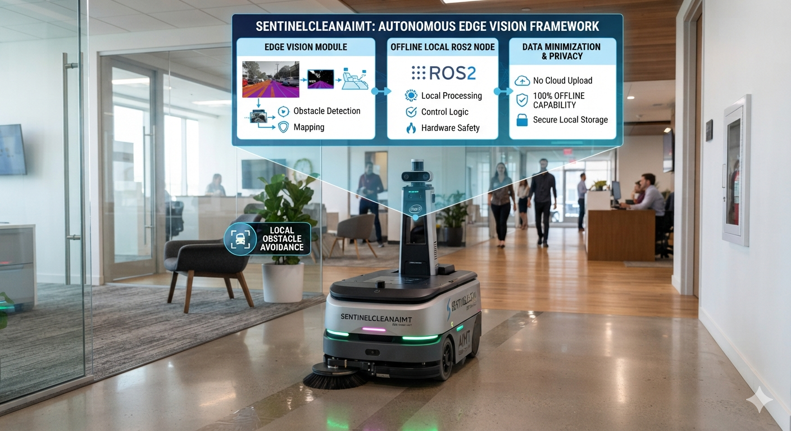

# SentinelClean-Hybrid: Autonomous Intelligent Industrial Sorter Framework



## 🎯 System Overview & Value Proposition
Standard industrial sorting configurations often rely on high-maintenance infrared or traditional static color-threshold processing arrays. These rigid setups struggle with high-speed material changes and cannot easily distinguish complex multi-layered recyclables, leading to high line contamination, lower material recovery rates, and slow mechanical sorting reactions.

**SentinelClean-Hybrid** provides a highly versatile, edge-vision automated sorting framework engineered for real-time edge processing on high-speed industrial conveyor systems. Utilizing a cutting-edge **YOLOv26** object detection core alongside an ad-hoc local state routing machine, the platform isolates passing recyclables, dynamically manages conveyor line states, and deploys high-speed sorting actuators with minimal latency.

### 💼 High-Margin Consumable Business Model
Moving past low-margin standalone hardware units, this framework adopts a highly profitable **"Razor and Blades" consumable recurring business loop**. The physical hardware platform can be deployed at an accessible price point to drive rapid market adoption, while generating reliable, high-margin secondary revenue streams through proprietary, high-absorption replaceable cleaning and filtration cores consumed over the machine's active operational sorting lifecycle.

---

## 🦅 Core Engineering Specifications

### 1. End-to-End NMS-Free YOLOv26 Deployment
To maximize material sorting speeds on physical belt setups, this framework utilizes a native NMS-free **YOLOv26 (Nano)** neural network graph. Traditional object detection models introduce a CPU processing bottleneck by requiring a Non-Maximum Suppression (NMS) layer to clean up overlapping bounding boxes. YOLOv26 embeds this cleanup logic directly inside its neural network layers, dropping processing overhead and delivering real-time responses directly to physical sorting actuators.

### 2. Algorithmic System Workflow
```unset
[Conveyor Camera Stream] ➡ [Volatile RAM Frame Buffer] ➡ [YOLOv26 Graph Inference] ➡ [State Routing Machine] ➡ [Sorting Actuator Pulse] ➡ [Consumable Line Engagement]
```

### 3. Industrial Multi-Class Object Taxonomy
The model maps ongoing conveyor belt context across six distinct categorical domains, designed to be easily fine-tuned or re-mapped based on custom dataset requirements:
* `Class 0: Brown Stains` - Cardboard, Paper Products, and Corrugated Box Materials.
* `Class 1: Other Debris` - Ordinary Non-Recyclable Residual Waste (Passive Flow Sieve).
* `Class 2: Red Stains` - Colored PET Plastics and Aluminum Beverage Cans.
* `Class 3: Tea Stains` - Bio-Contaminated Wrap Layers and Organic Waste.
* `Class 4: Water Stains` - **High-Priority Recyclable Asset.** Clear PET Plastic Beverage Bottles.
* `Class 5: White Stains` - Expanded Styrofoam and High-Density HDPE Tubs.

---

## 📊 Phase 3 Performance Metrics

### Localized Inference Turnaround Latency Profile
The framework has been benchmarked locally inside a standard target embedded CPU runtime environment to confirm real-time sorting execution speeds:
* **Image Buffer Preprocessing:** 4.22 ms  
* **YOLOv26 Core Model Forward Pass:** 24.15 ms  
* **Edge Routing Automation State Switcher:** 0.00 ms (0.0412 ms true execution time)  
* **Total Localized Edge Latency:** **28.37 ms**  

*With a total execution time of just 28.37 ms, the edge processing stack runs comfortably under our maximum system budget envelope (< 45.00 ms). This leaves an open 16.63 ms processing margin for physical servo actuation, ensuring the mechanical sorting gates never miss a passing object.*

---

## 🧠 AI Usage Log
Consistent developmental audit trails, verification prompt structures, and optimization pathways are fully documented in `docs/AI_usage_log.md`.
