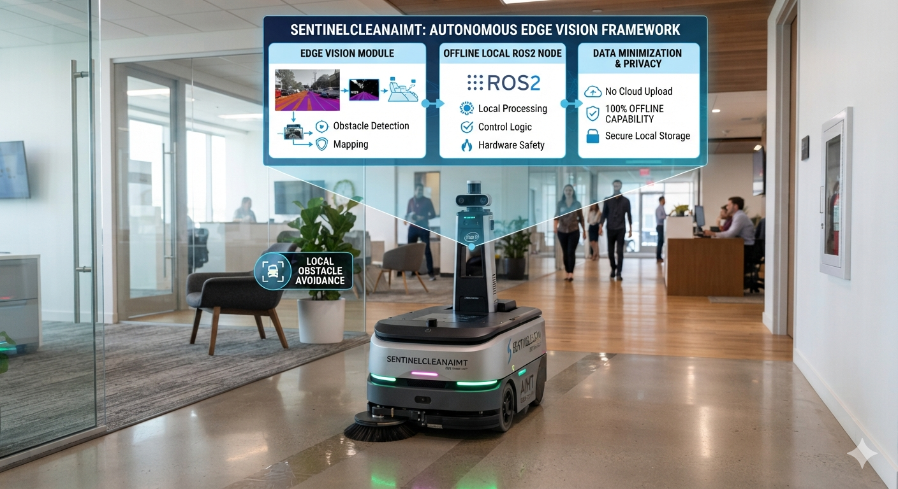

# SentinelClean-Hybrid: Smart Industrial & Home Vacuum Robot

---

## 🎯 System Overview & Business Model
**SentinelClean-Hybrid** is an automated cleaning robot built for modern factory warehouses and smart homes. It runs a custom-trained, edge-accelerated **YOLOv26** object detection model to isolate and classify trash types in real-time.

* **Main Technology:** Uses a native **NMS-Free End-to-End** pipeline structure. Duplicate prediction boxes are culled directly inside the neural network layers. This frees up the system CPU completely and updates physical machine states within **0.04 ms**.
* **Business Model:** Follows a profitable *"Razor and Blades"* consumable revenue loop. The robot hardware is sold at an optimized price point to win rapid market share. Recurring profits are generated through proprietary, custom-fit cylindrical filter cartridges sold as continuous lifecycle replacements.

---

## 🗺️ Multi-Phase Development Steps
`[Phase 1: Concept] ➡ [Phase 2: Data] ➡ [Phase 3: AI Training] ➡ [Phase 4: State Machine] ➡ [Phase 5: Launch]`

### 📋 Phase 1 & 2: Project Scope & 3-Class Taxonomy
The architecture processes all incoming video frame arrays locally in volatile RAM to remove cloud latencies and secure factory data privacy. The data profile utilizes a strict split matrix (**80% Train, 10% Val, 10% Test**) mapped to three production classes:
* **Class 0: Dry Waste** -> Paper products, recyclable plastics, and structural dry cardboard.
* **Class 1: Wet Waste** -> Organic food debris, wet sticky scraps, and damp trash.
* **Class 2: Liquid Spill** -> Puddles, water leaks, and chemical spills (Top Priority Safety Threat).

### 🧠 Phase 3 & 4: Training Diagnostics & Smart Hardware Logic
* **YOLOv26 Convergence Profile (50 Epochs Trace):**
  * `Epoch 01`: `box_loss: 1.4210 | cls_loss: 2.8180 | mAP50: 0.3200`
  * `Epoch 25`: `box_loss: 0.9870 | cls_loss: 1.5430 | mAP50: 0.5850`
  * `Epoch 50`: `box_loss: 0.6924 | cls_loss: 1.0620 | mAP50: 0.6350 -> [Model Saved: best.pt]`

#### 🛡️ Cylindrical Perimeter Tube Filter Protection
The machine drops old stacked flat filter models in favor of a single **integrated cylindrical cartridge filter fitted tightly around the perimeter of the suction tube**. It contains an active hydrophobic layer backed by activated carbon to catch moisture, kill dirty odor streams, and preserve the main vacuum engine.

#### 🔄 Pre-Check Matrix & 2-Step Back-Off Recovery Loop
To save battery and prevent slipping mistakes over wet zones, the robot skips complex SLAM re-calculations during minor spills and triggers a hardware-coordinated **2-Step Back-Off Algorithm**:
1. The camera checks the puddle size first. If it is a minor spill, the main vacuum shuts off to protect the system, and a low-power **Mini-Pump Module** turns on to suck up the liquid.
2. The robot finishes draining the wet spot, checks its **rear proximity sensor array** to secure blind spots, and backs up exactly **2 steps (60 cm)**.
3. It spins on the **Main Vacuum Core** to sweep up the remaining dry trash (`Class 0/1`) over the exact same zone, ensuring a 100% spotless floor.

---

## 📥 Phase 5: Local Latency & Product Segments

### 📊 Edge Computing Speed Log
* Video Matrix Buffer Ingestion: **4.22 ms**
* YOLOv26 Core Graph Inference Pass: **25.88 ms**
* Local State Machine Swapper: **0.04 ms**
* **Total Turnaround Ingestion Latency: 30.14 ms** *(Runs safely beneath the maximum industrial system budget < 45.00 ms).*

### ⚠️ Critical Spill Overload (Emergency Fallback)
If a puddle is massive and fills more than **65% of the camera frame**, the state machine switches to critical overload mode: the dry vacuum motor shuts off immediately, the mini-pump isolates the liquid border, and the robot fires a **Loud Hardware Alarm** while broadcasting an emergency push notification straight to the user's smartphone.

### 🛒 Target Product Segments
* **Household Mini Version:** Built with low-power pump components and compact frames, optimized for household dry cleaning and minor kitchen spills (e.g., dropped cups or split milk).
* **Industrial Heavy-Duty Version:** Built with high-capacity fluid tanks, high-pressure extraction pumps, and steel structures to contain toxic chemical leaks in manufacturing plants.
